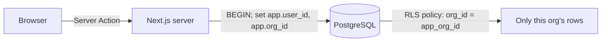

# KeyResult

**Multi-tenant OKR tracker.** Teams create workspaces, set quarterly objectives with measurable key results, record weekly check-ins, and see progress roll up. Workspaces have owners, admins and members, invite links, optional Stripe billing, and an append-only audit log.

Built with **Next.js 16** (App Router, Server Actions), **TypeScript**, **PostgreSQL** with row-level security, **argon2id**, **Zod**, **Stripe** (test mode), and **Vitest** integration tests against a real database.

## Why it's interesting

Most multi-tenant apps rely on every query remembering `WHERE org_id = ?`. One missed clause leaks another customer's data. KeyResult enforces isolation **in the database**:



- The app connects as `keyresult_app`, a role that **does not own the tables**, has **no `BYPASSRLS`**, and can't run DDL.
- Each request runs in a transaction that sets `app.user_id` and `app.org_id`. Row-level security policies on every tenant table filter and check writes against those settings.
- Child tables use **composite foreign keys** (`(objective_id, org_id)`), so a key result can't point at another tenant's objective even through a bug.
- The test suite proves it: queries with no `WHERE`, cross-tenant updates and deletes, inserts with a forged `org_id`, and `SET row_security = off` all fail.

## Security model

| Area | What's done |
|---|---|
| Tenant isolation | Postgres RLS on every tenant table; least-privilege runtime role; composite FKs |
| Passwords | argon2id (19 MiB, t=2), constant-time-ish login for unknown emails, 10+ character minimum |
| Sessions | 256-bit random tokens; only the SHA-256 is stored; `HttpOnly`, `SameSite=Lax`, `__Host-` + `Secure` in production; 30-day sliding expiry; "log out everywhere" |
| CSRF | Server Actions only accept same-origin requests (built into Next.js), plus `SameSite` cookies |
| Brute force | Postgres-backed rate limits per IP and per account on login, and per IP on sign-up |
| Authorization | Every Server Action re-loads the session and membership; role checks in the service layer; the last owner can't be removed or demoted |
| Invitations | Single-use, 7-day expiry, only the token hash stored, must be accepted by the invited email, `no-referrer` on the invite page |
| Input | Zod validation and length limits in the app, plus `CHECK` constraints in the schema |
| Headers | Per-request nonce CSP with `strict-dynamic`, `frame-ancestors 'none'`, HSTS, `nosniff`, Referrer-Policy, Permissions-Policy; `X-Powered-By` removed |
| Billing | Stripe webhook signatures verified on the raw body; org ids come only from server-set metadata; plan changes are idempotent and audited |
| Audit | The app role can insert and read audit entries but can't update or delete them |
| Errors | Expected failures return safe messages; anything else shows Next.js's generic error page |
| Supply chain | npm install scripts blocked by default; `npm audit` and gitleaks in CI; Dependabot |
| Secrets | None in the repo. Local passwords are generated into a git-ignored `.env` |

**Known limits** (worth knowing in an interview): rate limiting trusts `X-Forwarded-For`, so deploy behind a proxy that sets it. There's no email sending, so invite links are shown to the inviter to copy. The plan-limit checks aren't serialized, so two simultaneous requests could exceed a limit by one. The dev-only ESLint toolchain has a moderate `minimatch` advisory; it doesn't ship to production.

## Run locally

Requirements: Node.js 22+. Docker is optional.

```bash
npm install
cp .env.example .env
# Replace every change-me value in .env with a random secret:
#   node -e "console.log(require('crypto').randomBytes(24).toString('base64url'))"
```

Start Postgres, using **either** option:

```bash
npm run db:dev                       # embedded Postgres from npm, no Docker (leave it running)
docker compose up -d                 # or Docker
```

Then, in another terminal:

```bash
npm run db:migrate                   # creates tables, RLS policies and the least-privileged app role
npm run dev                          # http://localhost:3000
```

Sign up, create a workspace, add an objective and key results, check in, and invite a teammate from **Members**. Open the invite link in a private window and sign up with the invited email.

### Optional: Stripe test mode

1. In the Stripe dashboard (test mode), create a recurring price and copy its id.
2. Set `STRIPE_SECRET_KEY` (a `sk_test_` key), `STRIPE_PRICE_ID`, and `STRIPE_WEBHOOK_SECRET` in `.env`.
3. Forward webhooks with the Stripe CLI: `stripe listen --forward-to localhost:3000/api/stripe/webhook`, which prints the webhook secret.
4. Upgrade from **Billing** with test card `4242 4242 4242 4242`.

## Tests

```bash
npm test
```

The tests start a throwaway embedded Postgres, run the real migrations, and exercise the service layer against it. No Docker or configuration is needed. In CI they run against a Postgres service container.

| Suite | Covers |
|---|---|
| `tenant-isolation` | RLS on reads, writes and forged inserts; composite FKs; RLS can't be disabled; audit log is append-only |
| `auth` | argon2id storage, login, vague duplicate-email errors, session hashing, expiry, renewal, log out everywhere, rate limits |
| `permissions` | Invite single use, email binding, expiry; role rules; last-owner protection; plan limits; audit trail |
| `billing-and-units` | Stripe signature verification and tampering, plan upgrades and downgrades, OKR progress math, validation |

## Project structure

```
app/
  (auth)/            login, signup, session actions
  app/               signed-in area: workspaces, objectives, members, audit log, billing
  invite/[token]/    accept an invitation
  api/stripe/        verified Stripe webhook
lib/
  db.ts              connection pool and withContext() (sets the RLS context)
  auth/              password hashing, session tokens, cookie handling
  services/          business rules: accounts, orgs, OKRs, members, billing, audit
  permissions.ts     roles and plan limits
  validation.ts      Zod schemas
migrations/          SQL schema and RLS policies
scripts/             migrations and the embedded dev database
proxy.ts             CSP nonce and signed-out redirect
tests/               integration tests
```

## Deploying

Any Node host works (Render, Fly.io, Railway, a VM, or a container) with a managed Postgres. Run `npm run db:migrate` with `DATABASE_OWNER_URL` during deploys, give the app only `DATABASE_URL` (the least-privileged role), set `APP_URL`, and put it behind HTTPS.

## License

MIT
